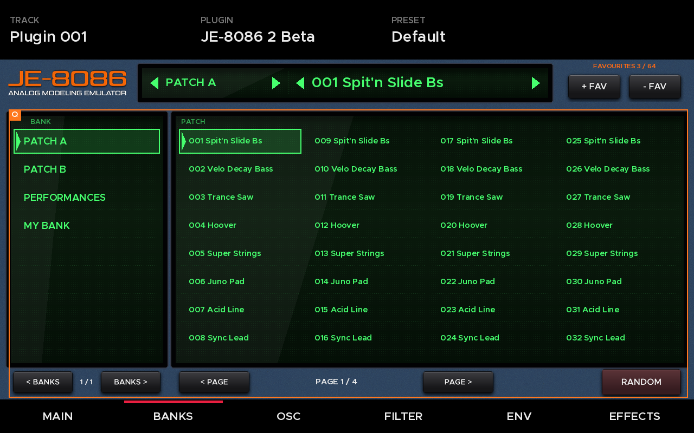

# JE-8086 for MPC

A Roland JP-8000 emulation that runs as a plugin instrument on **Akai MPC Gen2 standalone devices** (MPC Live III and other aarch64 MPCs),
with a full touchscreen editor and Q-Link control.

It runs the JP-8000's original firmware on [gearmulator](https://github.com/dsp56300/gearmulator)'s emulation of the synth's chips.
The ARM64 speed-ups come from [schwung-je8086](https://github.com/charlesvestal/schwung-je8086). The look comes from gearmulator's
"jeTrancy" JE-8086 skin.


## Features
- **The real JP-8000 engine:** the original OS runs on emulated hardware, so you get the supersaw, feedback osc, filters, effects, arpeggiator and
  Upper/Lower performance modes of the original.
- **All sounds included in the ROM:** the factory patch banks and 64 performances, browsable on the BANKS page, 32 per page. You can also add
  your own bank files (`.syx .mid .pat .pfm .j8k`). **RANDOM** picks a sound from every bank.
- **Favourites with names, in the MPC PRESET menu:** press **+FAV**, type a name on the on-screen keyboard and SAVE. Pick it from MPC's own
  preset list; **-FAV** removes it. Up to 64 favourites, kept across projects.
- **A native MPC skin** in the JP-8000's look, built for the touchscreen:
  - **MAIN:** one LCD (bank, patch, status), the play-mode keys, big filter and effects knobs, long amp envelope faders, INIT, RELOAD, PANIC
  - **BANKS:** patch and performance browser, RANDOM
  - **OSC**, **FILTER / AMP**, **ENVELOPES** (live envelope graphs you can drag), **EFFECTS**, **PERFORM** (key mode, voices, arpeggiator)
  - **CONTROL** and **VELOCITY:** the morph and velocity assignments
- **Q-Links:** every block of controls is a Q-Link group.
- **Tempo sync:** the arpeggiator and the synced delay, chorus and LFO follow MPC's tempo.
- **INIT:** a plain starting sound (one saw, filter open, no effects) for building your own.
- **Any MIDI channel:** the track's channel doesn't matter.
- **Saved with your project:** the current sound and every edit come back when the project is reopened. Projects saved with 0.1.x still load.



## Requirements
- An MPC Gen2 standalone device (aarch64, e.g. MPC Live III) running **MPC OS 3.10 or later**. Gen1 devices and the Force aren't supported:
  the emulator's recompiler has no 32-bit ARM backend.
- **Your own JP-8000 ROM.** No ROM is included, and none may be shared. Either the eight JP-8000 OS update files (`_00001.mid` to `_00008.mid`)
  or a full ROM dump (`.bin`) work.

## Install
- **Plugin Manager** (or the Open MPC catalog): install **JE-8086**, then add your ROM in its ROM step.
- **By hand:** download `JE-8086-<version>-mpc-sdk.zip` from [Releases](https://github.com/sd88me/mpc-vst-je8086/releases), unzip it and copy the
  `sd88me - VST - JE-8086` folder into `VST2 Plugins` on a drive the MPC can see. Put your ROM files in its `je8086/roms/` folder (optional:
  extra banks in `je8086/banks/`).
- **Upgrading from 0.1.x:** install over the old folder (merge it, don't delete the old folder first) so your ROM and favourites stay.

Load **JE-8086** on a plugin track. The firmware boots in about a second; if the status line on MAIN says no ROM was found, check the ROM folder.

## Tips
- Notes from the MPC go into the JP-8000's own keyboard input, so the arpeggiator, Split and Dual key modes all work.
- A MIDI program change picks a sound from the current bank.
- **RELOAD** reverts your edits to the stored sound. **INIT** starts from a plain sound. **PANIC** stops stuck notes and lets go of a held arpeggio.
- A new instance starts in SINGLE key mode with the panel on both parts and the arpeggiator off.

## Building from source
You need Docker, Python 3 with Pillow, the Akai MPC Plugin SDK (`SDK`) and a checkout of [mpc-vst-plugins](https://github.com/sd88me/mpc-vst-plugins)
(`MPC_VST`).
```
./build-sdk.sh test           # x86 host tests (ASan/UBSan) and the SDK's host_sim
./build-sdk.sh                # aarch64 plugin folder in build/sdk/
tools/package.sh              # dist/JE-8086-<version>-mpc-aarch64.zip and -mpc-sdk.zip
```
The skin is generated: `tools/make_tui.py --preview` writes `skins/` and mock-ups in `docs/skin-preview/`.

## Credits
JE-8086 for MPC is built on other people's work. See [CREDITS.md](CREDITS.md) for the details.
- **[gearmulator](https://github.com/dsp56300/gearmulator)** by dsp56300 and contributors: the JP-8000 emulation and the JE-8086 plugin it comes from.
- **[schwung-je8086](https://github.com/charlesvestal/schwung-je8086)** by Charles Vestal: the ARM64 performance work, the parameter table and the
  bank reader.
- **The "jeTrancy" skin** by theusualsuspects: the panel look, wordmark and knobs.
- **[mpc-vst-plugins](https://github.com/sd88me/mpc-vst-plugins):** the release and installer tools.
- **Akai MPC Plugin SDK:** the plugin framework.

## Licence
**GPL-3.0**: see [LICENSE](LICENSE). The bundled components keep their own licences (GPL-3.0, zlib, BSD/LGPL, SIL OFL 1.1), as listed in CREDITS.md.

*JE-8086 is an independent project, not affiliated with or endorsed by Roland. "JP-8000" is the name of the instrument it emulates. Roland and JP-8000
are trademarks of their owners.*
