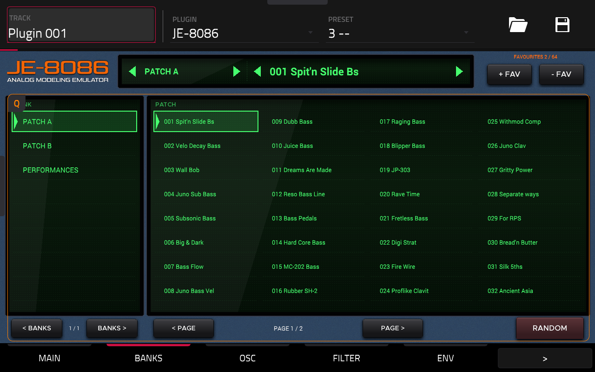
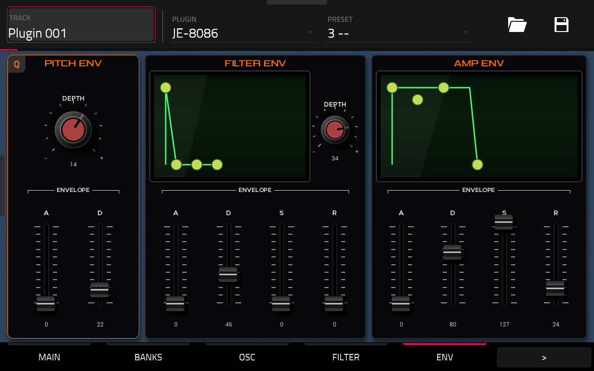

# JE-8086 for MPC

A Roland JP-8000 emulation that runs as a plugin instrument on **Akai MPC Gen2 standalone devices** (MPC Live III and other aarch64 MPCs),
with a full touchscreen editor and Q-Link control.

It runs the JP-8000's original firmware on [gearmulator](https://github.com/dsp56300/gearmulator)'s emulation of the synth's chips.
The ARM64 speed-ups come from [schwung-je8086](https://github.com/charlesvestal/schwung-je8086). The look comes from gearmulator's
"jeTrancy" JE-8086 skin.


## Features
- **The real JP-8000 engine:** the original OS runs on emulated hardware, so you get the supersaw, feedback osc, filters, effects, arpeggiator and
  Upper/Lower performance modes of the original.
- **All sounds included in the ROM:** the factory patch banks and 64 performances, browsable on the BANKS page, 32 per page. You can also add
  your own bank files (`.syx .mid .pat .pfm .j8k`). **RANDOM** picks a sound from every bank.
- **Favourites with names, in the MPC PRESET menu:** press **+FAV**, type a name on the on-screen keyboard and SAVE. Pick it from MPC's own
  preset list; **-FAV** removes it. Up to 64 favourites, kept across projects.
- **A native MPC skin** in the JP-8000's look, built for the touchscreen:
  - **MAIN:** one LCD (bank, patch, status), the play-mode keys, big filter and effects knobs, long amp envelope faders, INIT, RELOAD, PANIC
  - **BANKS:** patch and performance browser, RANDOM
  - **OSC**, **FILTER / AMP**, **ENVELOPES** (live envelope graphs you can drag), **EFFECTS**, **PERFORM** (key mode, voices, arpeggiator)
  - **CONTROL** and **VELOCITY:** the morph and velocity assignments
- **Q-Links:** every block of controls is a Q-Link group.
- **Tempo sync:** the arpeggiator and the synced delay, chorus and LFO follow MPC's tempo.
- **INIT:** a plain starting sound (one saw, filter open, no effects) for building your own.
- **Any MIDI channel:** the track's channel doesn't matter.
- **Saved with your project:** the current sound and every edit come back when the project is reopened. Projects saved with 0.1.x still load.





## Requirements
- An MPC Gen2 standalone device (aarch64, e.g. MPC Live III) running **MPC OS 3.10 or later** (3.10.1 or later for the SDK-format zip). Gen1 devices and the Force aren't supported:
  the emulator's recompiler has no 32-bit ARM backend.
- **Your own JP-8000 ROM.** No ROM is included, and none may be shared. Either the eight JP-8000 OS update files (`_00001.mid` to `_00008.mid`)
  or a full ROM dump (`.bin`) work.

## Install
There are two plugin formats. Use one of them, not both: they are the same plugin.

| Plugin format | Zip | How it is installed | Plugin folder |
|---|---|---|---|
| **SDK format** (MPC OS 3.10.1 or later) | `JE-8086-<version>-mpc-sdk.zip` | By hand: unzip it, copy the folder `sd88me - VST - JE-8086` into `VST2 Plugins` at the root of a drive the MPC can see, turn on **Preferences > Enhancements (Beta) > Enable Enhancements** and **External Plugin Support**, and restart the MPC | `VST2 Plugins/sd88me - VST - JE-8086/` on that drive |
| **Older format** (plugins listed in `MPC.settings`) | `JE-8086-<version>-mpc-aarch64.zip` | With the **OpenMPC Plugin Manager**, or by hand over SSH with the zip's `install.sh` (needs root access; on a Live III add `-t /nvme/Synths`) | `sd88me - VST - JE-8086/` in the Synths folder it was installed to |

Both zips are on [Releases](https://github.com/sd88me/mpc-vst-je8086/releases).

### Adding your ROM
Put your ROM files in the plugin folder's `je8086/roms/` (the zip already has the folder), for example
`VST2 Plugins/sd88me - VST - JE-8086/je8086/roms/`. Extra banks go in `je8086/banks/` (optional). Copy them over USB, with
`scp`, or with the MPC's file browser. This is the same for both formats: the OpenMPC Plugin Manager has no ROM step for
JE-8086, so copy the ROM by hand after installing.

### Upgrading
- **SDK format:** copy the new folder over the old one (merge it, don't delete the old folder first) so your ROM, banks and
  favourites stay. A 0.1.x install copied by hand keeps working: its ROM in `VST/je8086/roms/` is used while `je8086/roms/` is empty.
- **Older format:** the OpenMPC Plugin Manager and `install.sh` upgrade in place and keep `je8086/roms/`, `je8086/banks/` and
  your favourites.

Load **JE-8086** on a plugin track. The firmware boots in about a second; if the status line on MAIN says no ROM was found, check the ROM folder.

## Backing up your favourites and sounds

Your favourites and your own files are kept in the plugin folder on the MPC, not in your projects (a project keeps only the sound its
track uses). Back them up before you update the plugin or MPC OS, reset the device, or move to another MPC. These are the files to keep,
inside the plugin folder `sd88me - VST - JE-8086`:

| File or folder | What it holds |
|---|---|
| `je8086/favourites.dat` | your favourites (+FAV) |
| `je8086/banks/` | your extra banks |
| `je8086/roms/` | your ROM |

Your ROMs are yours to keep with your backup, but don't share them.

### Where the plugin folder is
It is in `VST2 Plugins` on one of the MPC's drives, or in a Synths folder (`/sdcard/Synths`, or `/nvme/Synths` on a Live III),
depending on how JE-8086 was installed. Over SSH (root access), this prints its path:

```bash
ssh root@<device-ip> 'find /sdcard /nvme /media -maxdepth 3 -type d -name "sd88me - VST - JE-8086" 2>/dev/null'
```

### Backing up
- **The plugin folder is on an SD card or USB drive:** plug the drive into a computer and copy the files above to it.
- **Over SSH**, from a computer: this copies the whole plugin folder into one file, `je8086-backup.tar`. Put the folder that holds the
  plugin folder (the path above without its last part) in place of `<parent folder>`:

  ```bash
  ssh root@<device-ip> 'cd "<parent folder>" && tar cf - "sd88me - VST - JE-8086"' > je8086-backup.tar
  ```

### Restoring
Install JE-8086 first (on the new device, or after the reset or update), then put back only the files above. Don't copy the whole
old folder over the new one: that would put the old version of the plugin back too.

- **From a drive:** copy the files back to the same places in the new plugin folder.
- **Over SSH:** unpack the backup on your computer and send the files back. List only the ones your backup has, and put the new
  plugin folder's path (found as above) in place of `<plugin folder>`:

  ```bash
  mkdir je8086-backup && tar xf je8086-backup.tar -C je8086-backup
  tar cf - -C "je8086-backup/sd88me - VST - JE-8086" "je8086/favourites.dat" "je8086/banks" "je8086/roms" | ssh root@<device-ip> 'cd "<plugin folder>" && tar xf -'
  ```

Then remove JE-8086 from its tracks and add it again (or reopen the project), so it reads the restored files.

## Tips
- Notes from the MPC go into the JP-8000's own keyboard input, so the arpeggiator, Split and Dual key modes all work.
- A MIDI program change picks a sound from the current bank.
- **RELOAD** reverts your edits to the stored sound. **INIT** starts from a plain sound. **PANIC** stops stuck notes and lets go of a held arpeggio.
- A new instance starts in SINGLE key mode with the panel on both parts and the arpeggiator off.

## Building from source
You need Docker, Python 3 with Pillow, the Akai MPC Plugin SDK (`SDK`) and a checkout of [mpc-vst-plugins](https://github.com/sd88me/mpc-vst-plugins)
(`MPC_VST`).
```
./build-sdk.sh test           # x86 host tests (ASan/UBSan) and the SDK's host_sim
./build-sdk.sh                # aarch64 plugin folder in build/sdk/
tools/package.sh              # dist/JE-8086-<version>-mpc-aarch64.zip and -mpc-sdk.zip
```
The skin is generated: `tools/make_tui.py --preview` writes `skins/` and mock-ups in `docs/skin-preview/`.

## Credits
JE-8086 for MPC is built on other people's work. See [CREDITS.md](CREDITS.md) for the details.
- **[gearmulator](https://github.com/dsp56300/gearmulator)** by dsp56300 and contributors: the JP-8000 emulation and the JE-8086 plugin it comes from.
- **[schwung-je8086](https://github.com/charlesvestal/schwung-je8086)** by Charles Vestal: the ARM64 performance work, the parameter table and the
  bank reader.
- **The "jeTrancy" skin** by theusualsuspects: the panel look, wordmark and knobs.
- **[mpc-vst-plugins](https://github.com/sd88me/mpc-vst-plugins):** the release and installer tools.
- **Akai MPC Plugin SDK:** the plugin framework.

## Licence
**GPL-3.0**: see [LICENSE](LICENSE). The bundled components keep their own licences (GPL-3.0, zlib, BSD/LGPL, SIL OFL 1.1), as listed in CREDITS.md.

*JE-8086 is an independent project, not affiliated with or endorsed by Roland. "JP-8000" is the name of the instrument it emulates. Roland and JP-8000
are trademarks of their owners.*
