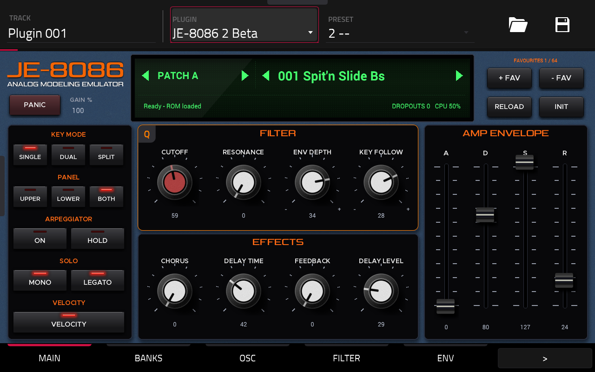

# JE-8086 for MPC

A Roland JP-8000 emulation that runs as a plugin instrument on **Akai MPC Gen2 standalone devices** (MPC Live III and other aarch64 MPCs),
with a full touchscreen editor and Q-Link control.

It runs the JP-8000's original firmware on [gearmulator](https://github.com/dsp56300/gearmulator)'s emulation of the synth's chips.
The ARM64 speed-ups come from [schwung-je8086](https://github.com/charlesvestal/schwung-je8086). The look comes from gearmulator's
"jeTrancy" JE-8086 skin.



## Features
- **The real JP-8000 engine:** the original OS runs on emulated hardware, so you get the supersaw, feedback osc, filters, effects, arpeggiator and
  Upper/Lower performance modes of the original.
- **All sounds included in the ROM:** the factory patch banks and 64 performances, browsable on the BANKS page, 32 per page. You can also add
  your own bank files (`.syx .mid .pat .pfm .j8k`).
- **Favourites in the MPC PRESET menu:** press **+FAV** on any patch to save it, then pick it from MPC's own preset list. **-FAV** removes it.
  Up to 64 favourites, kept across projects.
- **A complete editor on the touchscreen:** 10 pages covering every panel control, with LCD-style readouts in the JP-8000's green on black.
  - **MAIN:** bank/patch, edit part, key mode, voices, split, detune, tempo, gain, engine status, PANIC and 8 quick-edit knobs
  - **BANKS:** patch and performance browser, favourites
  - **OSC:** LFO 1, OSC 1, OSC 2, Osc Common, pitch envelope
  - **FILTER:** filter, filter envelope, LFO 2 modulation
  - **AMP:** amp, amp envelope, portamento and solo
  - **EFFECTS:** tone, chorus, delay
  - **ARP & PARTS:** arpeggiator and part settings
  - **TRIG & MORPH**, **CONTROL**, **VELOCITY:** morph and velocity assignments
- **Q-Links:** each page's knobs are mapped to the Q-Links.
- **Saved with your project:** the current sound and every edit come back when the project is reopened.
- **Light on CPU:** about 55-65% of one core on an MPC Live III, with no dropouts in testing.


## Requirements
- An MPC Gen2 standalone device (aarch64, e.g. MPC Live III) running **MPC OS 3.10 or later**. Gen1 devices and the Force aren't supported:
  the emulator's recompiler has no 32-bit ARM backend.
- **Your own JP-8000 ROM.** No ROM is included, and none may be shared. Either the eight JP-8000 OS update files (`_00001.mid` to `_00008.mid`)
  or a full ROM dump (`.bin`) work.

## Install
1. Download `JE-8086-<version>-VST2-Plugins.zip` from [Releases](https://github.com/sd88me/mpc-vst-je8086/releases) and unzip it.
2. Copy the `VST2 Plugins` folder to the root of a drive the MPC can see (internal storage, SD card or USB drive). If that drive already has a
   `VST2 Plugins` folder, copy the `sd88me - VST - JE-8086` folder into it.
3. Put your ROM files in `VST2 Plugins/sd88me - VST - JE-8086/VST/je8086/roms/`.
4. Optional: put extra bank files in `.../VST/je8086/banks/`.
5. On the MPC, turn on **Preferences > Enhancements (Beta) > Enable Enhancements and VST2 Support**, then restart.
6. Load **JE-8086** on a plugin track from the External VST Plugins list.

The plugin boots its firmware in about a second after it is loaded. If the STATUS readout on MAIN says no ROM was found, check step 3.

## Tips
- Notes from the MPC go into the JP-8000's own keyboard input, so the arpeggiator, Split and Dual key modes all work.
- A MIDI program change picks a sound from the current bank.
- **RELOAD PATCH** reverts the edits to the stored patch. **PANIC** stops stuck notes.
- The arpeggiator runs at the TEMPO knob's tempo. It doesn't follow MPC's clock yet.

## Building from source
You need Docker, Python 3 with Pillow, and a checkout of [mpc-vst-plugins](https://github.com/sd88me/mpc-vst-plugins). Point `MPC_VST` at it
(the default is `~/mpc-vst-plugins`).
```
./build.sh test               # x86 engine + the wrapper's host test (ASan/UBSan)
./build.sh all                # aarch64 vst/build/aarch64/je8086.so + the skin
tools/package_310.sh 0.1.1    # dist/JE-8086-0.1.1-VST2-Plugins.zip
```
`build/<arch>/je8086_engine_test <dir with roms/>` boots the ROM and checks notes, presets, parameters and the saved state. Run the aarch64 one on the device.

## Credits
JE-8086 for MPC is built on other people's work. See [CREDITS.md](CREDITS.md) for the details.
- **[gearmulator](https://github.com/dsp56300/gearmulator)** by dsp56300 and contributors: the JP-8000 emulation and the JE-8086 plugin it comes from.
- **[schwung-je8086](https://github.com/charlesvestal/schwung-je8086)** by Charles Vestal: the ARM64 performance work, the parameter table and the
  bank reader.
- **The "jeTrancy" skin** by theusualsuspects: the panel look, wordmark and knobs.
- **[mpc-vst-plugins](https://github.com/sd88me/mpc-vst-plugins):** the MPC plugin wrapper and skin tools.

## Licence
**GPL-3.0**: see [LICENSE](LICENSE). The bundled components keep their own licences (GPL-3.0, zlib, BSD/LGPL, SIL OFL 1.1), as listed in CREDITS.md.

*JE-8086 is an independent project, not affiliated with or endorsed by Roland. "JP-8000" is the name of the instrument it emulates. Roland and JP-8000
are trademarks of their owners.*
